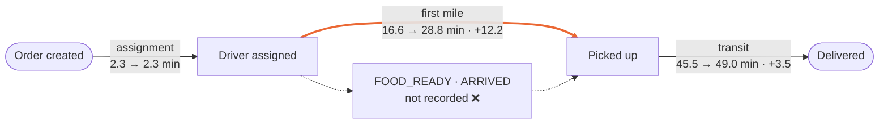
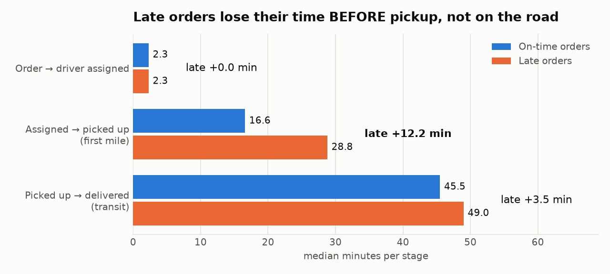
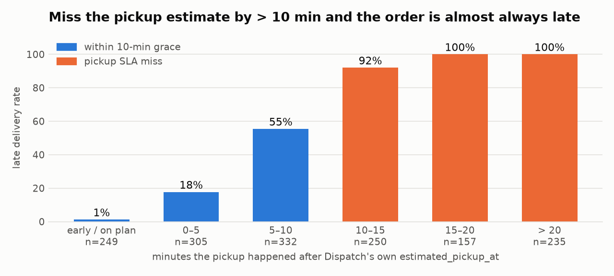
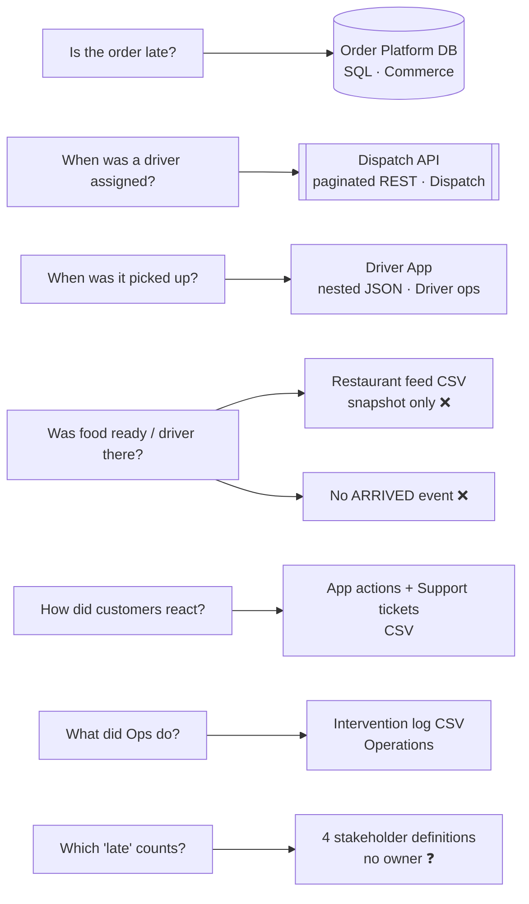
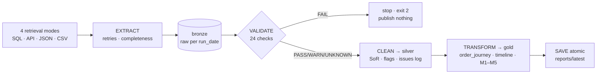

# FlashEats · Late-Delivery KPI Pipeline

**FDE Assignment 2 · Track A** — messy client systems → a dependable pipeline → one business decision.

> **Client ask:** “Customers are angry about late deliveries — build an AI system that predicts delays.”

| Business question | Answer |
|---|---|
| How often do we break the promise? | **56.5 %** of deliveries (23.2 % by > 10 min) |
| Where is the time lost? | **Before pickup**: +12 min for late orders; transit only +3.5 |
| Restaurant or driver? | **Can't tell yet**: no FOOD_READY / ARRIVED events |
| Do Ops interventions help? | **No measurable effect yet** (no control group) |
| **Decision:** fund the AI predictor? | **Not yet**: fix and instrument the first mile; track M1–M5 weekly |

## Problem · users · KPI

| | |
|---|---|
| **Business problem** | Late deliveries hurt customers; ETAs feel unreliable; “56 % late” has no agreed definition |
| **Outcome owner** | VP Operations |
| **Users of the output** | Ops & Dispatch leads, Support Lead, Restaurant Ops |
| **Data owners** | Order Platform · Dispatch · Driver App · Support · Customer App · Restaurant partnerships |
| **Project KPI** | **Late Delivery Rate** = delivered after `promised_eta` ÷ measurable delivered orders |

## Where the delay builds up (Class 7) → full model in [`docs/03_data_model.md`](docs/03_data_model.md)


<sub>Median minutes, on-time → late orders.</sub>

## Evidence table (regenerated every run → [`reports/latest/evidence_table.md`](reports/latest/evidence_table.md))

| # | Metric | Type | Today | Reads as |
|---|---|---|---|---|
| M1 | **Late Delivery Rate** | outcome · lagging (KPI) | **56.5 %** of 1,528 | 23.2 % are > 10 min late |
| M2 | **Pickup SLA Miss Rate** | workflow · leading | **42.0 %** | pickup > 10 min past estimate → **96.9 %** end late (vs 27.2 %) |
| M3 | **Customer Escalation Rate** | customer interaction | **29.9 %** of late orders | tickets alone see only 19 % |
| M4 | **Preventive Intervention Coverage** | intervention | **15.2 %** of late orders | no measurable effect yet |
| M5 | **ETA Drift** | diagnostic | **+8.1 min** | vs the *revised* ETA only 26 % look late |

<p> </p>

## Source map (Class 4) → full reasoning in [`docs/01_source_map.md`](docs/01_source_map.md)



| Fact | System of record | Not trusted for it (why) |
|---|---|---|
| promise | Order DB `promised_eta` | Dispatch ETA — revised upward, a moving target |
| delivery time | Order DB; Driver App as validated fallback | — |
| pickup time | **Driver App** | Order DB `pickup_at` — wrong for 5 orders, filled for cancelled ones |
| current driver | **Dispatch API** | Order DB (original driver), intervention log (overlaps on 4/79) |

## Pipeline (Class 5 + 6 + 8)



## Run it

```bash
python -m pip install -r requirements.txt           # tested on Python 3.13
python run_pipeline.py --run-date 2026-09-27        # starts the mock Dispatch API, runs every stage
python run_pipeline.py --run-date 2026-08-24 --from-date 2026-08-17 --to-date 2026-08-24   # one week
python -m pytest                                     # 13 tests: retries, gate, idempotency, safe failure
```

| Dependability (Class 8) | How | Prove it |
|---|---|---|
| Complete retrieval | page until `has_more=false`; counts reconciled per source | V02 in [`validation_report.md`](reports/latest/validation_report.md) |
| Bounded retries | 429/5xx only, backoff + `Retry-After`; 4xx fail fast | log `page=3 status=500 attempt=1/4` |
| Raw preserved | every source copied to bronze + sha256 | `--replay-raw` (no API needed) |
| Validation gate | FAIL ⇒ nothing published; reason in `data/failed_runs/` | `--chaos missing_column` / `stale_data` / `schema_drift` |
| Idempotent rerun | same `--run-date` ⇒ atomic replace, identical hashes | run twice, compare `run_manifest.json` |
| Source outage | exit 3; last good output untouched | `--chaos api_outage` |
| Config outside code | `pipeline.yaml` + `.env`; secrets git-ignored | [`config/.env.example`](config/.env.example) |
| Logging | stage · source · rows · attempt · decision | `logs/pipeline_<run-date>.log` |

## Known · Unknown · Assumption · Limitation

| | |
|---|---|
| **Known** | 56.5 % late; the gap opens between assignment and pickup; tickets under-count lateness 5× |
| **Unknown** | restaurant vs driver blame · the ETA the customer actually saw · whether interventions work · who owns the KPI |
| **Assumption** | `promised_eta` = customer promise · Driver App completion = truth when DB is blank · 18.0 km = default |
| **Limitation** | one 4-week classroom snapshot (Aug 2026, Bengaluru); descriptive, not causal |

## ⭐ FDE judgement call (demo) → all 9 calls in [`docs/05_decision_log.md`](docs/05_decision_log.md)

| | |
|---|---|
| **Situation** | 37 delivered orders lack a delivery time; the class answer and client dashboard drop them |
| **Call** | recover them from the Driver App, **only after** proving it matches the Order DB on all 1,495 overlapping orders |
| **Why** | 64.9 % were late: dropping them hid the worst orders |
| **Safeguard** | rows flagged `driver_app_recovered`; auto-off if agreement < 99 % (V12) |

## Where to find each grading area

| Rubric (20 % each) | Look here |
|---|---|
| Source reasoning | [`docs/01_source_map.md`](docs/01_source_map.md) · [`source_systems/README.md`](source_systems/README.md) |
| Retrieval | [`pipeline/extract.py`](pipeline/extract.py) · [`notebooks/Class5_Challenge_Retrieval.ipynb`](notebooks/Class5_Challenge_Retrieval.ipynb) · V02 |
| Validation | [`docs/02_validation_contract.md`](docs/02_validation_contract.md) · [`pipeline/validate.py`](pipeline/validate.py) · [`notebooks/Class6_Challenge_Validation.ipynb`](notebooks/Class6_Challenge_Validation.ipynb) · [`reports/latest/issues_log.csv`](reports/latest/issues_log.csv) |
| Workflow + metrics | [`docs/03_data_model.md`](docs/03_data_model.md) · [`docs/04_metrics.md`](docs/04_metrics.md) · [`notebooks/Class7_Challenge_Workflow_Model.ipynb`](notebooks/Class7_Challenge_Workflow_Model.ipynb) |
| Pipeline dependability | [`run_pipeline.py`](run_pipeline.py) · [`tests/`](tests/) · [`reports/latest/gate2_data_readiness.md`](reports/latest/gate2_data_readiness.md) |

<details><summary>Repo layout</summary>

```text
run_pipeline.py            one-command entry point (extract → validate → clean → transform → save)
pipeline/                  config · extract · validate · clean · transform · metrics · report · save
config/                    pipeline.yaml (thresholds, paths) · category_map.csv (agreed vocab) · .env.example
source_systems/            the client's systems, untouched (DB, Dispatch API, exports) + _not_ingested/ with reasons
notebooks/                 Class 5 / 6 / 7 challenge notebooks (exploration that became the pipeline)
reports/latest/            published evidence: evidence table, validation gate, Gate 2 review, charts, metrics.json
data/                      bronze / silver / gold partitions per run_date (regenerated, git-ignored)
docs/                      source map · validation contract · data model · metrics · decision log
tests/                     retry, validation-gate and end-to-end dependability tests
```
</details>
