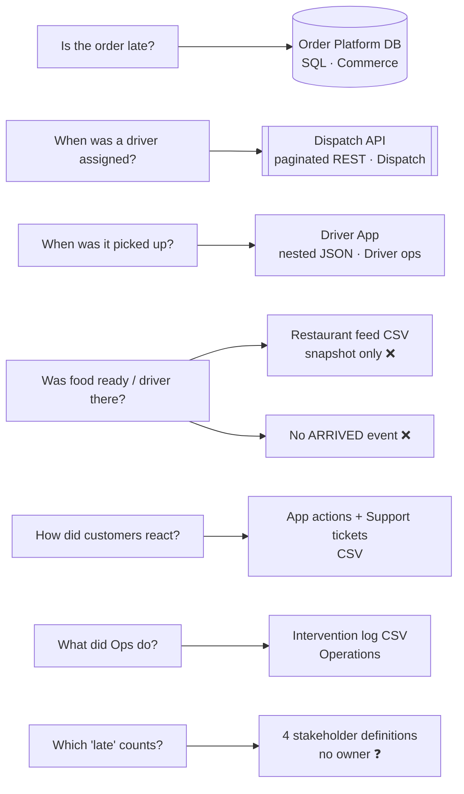
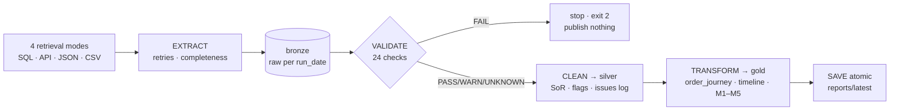

# FlashEats · Late-Delivery KPI Pipeline

**FDE Assignment 2 · Track A** — from messy client systems to a dependable, explainable pipeline that tells leadership *where* deliveries go late and what to fix first.

> **Client ask:** “Customers are angry about late deliveries — build an AI system that predicts delays.”
> **What the data says:** 56.5 % of deliveries break the promise, and late orders lose their time **before pickup** (+12 min), not on the road. The events that would say *whether the restaurant or the driver* is at fault are not recorded.
> **Decision supported:** **don't fund the AI predictor yet** — fix and instrument the first mile, and track the KPI weekly with this pipeline.

## Problem · users · KPI

| | |
|---|---|
| **Business problem** | Late deliveries hurt customer experience; ETAs feel unreliable; leadership quotes “56 % late” with no agreed definition |
| **Outcome owner** | VP Operations (owns the KPI) |
| **Users of the output** | Ops & Dispatch leads (where to intervene), Support Lead (escalations), Restaurant Ops |
| **Data owners** | Order Platform · Dispatch · Driver App · Support · Customer App · Restaurant partnerships |
| **Project KPI** | **Late Delivery Rate** = delivered after `promised_eta` ÷ measurable delivered orders |

## Evidence table (auto-generated each run → [`reports/latest/evidence_table.md`](reports/latest/evidence_table.md))

| # | Metric | Type | Today | Reads as |
|---|---|---|---|---|
| M1 | **Late Delivery Rate** | outcome · lagging (KPI) | **56.5 %** of 1,528 | 23.2 % are > 10 min late |
| M2 | **Pickup SLA Miss Rate** | workflow · leading · controllable | **42.0 %** | miss the pickup estimate by > 10 min → **96.9 %** end late (vs 27.2 %) |
| M3 | **Customer Escalation Rate** | customer interaction | **29.9 %** of late orders | tickets alone see only 19 % of late orders |
| M4 | **Preventive Intervention Coverage** | intervention | **15.2 %** of late orders | no measurable effect yet (association only) |
| M5 | **ETA Drift** | diagnostic | **+8.1 min** | vs the *revised* ETA only 26 % look late |

<p> </p>

## Source map (Class 4) → full reasoning in [`docs/01_source_map.md`](docs/01_source_map.md)



| Fact | System of record | Not trusted for it (why) |
|---|---|---|
| promise | Order DB `promised_eta` | Dispatch ETA — revised upward, a moving target |
| delivery time | Order DB; Driver App as validated fallback (100 % agreement) | — |
| pickup time | **Driver App** | Order DB `pickup_at` — wrong for 5 orders, filled for cancelled ones |
| current driver | **Dispatch API** | Order DB (original driver), intervention log (overlaps on 4/79) |

## Pipeline (Class 5 + 6 + 8)



## Run it

```bash
python -m pip install -r requirements.txt
python run_pipeline.py --run-date 2026-09-27        # one command: starts the mock Dispatch API, runs all stages
python run_pipeline.py --run-date 2026-08-24 --from-date 2026-08-17 --to-date 2026-08-24   # same code, one week
python -m pytest                                     # 13 tests: retries, gate, idempotency, safe failure, weekly window
```

| Dependability (Class 8) | How | Prove it |
|---|---|---|
| Complete retrieval | pages until `has_more=false`; rows = `total_records` = unique ids; SQL/file counts reconciled | V02 in `reports/latest/validation_report.md` |
| Bounded retries | 429/500/502/503/504 only, exponential backoff, `Retry-After` honoured; 4xx fail fast | log: `page=3 status=500 attempt=1/4` |
| Raw preserved | every source landed untouched in `data/bronze/run_date=…/` + sha256 manifest | `--replay-raw` rebuilds without the API |
| Validation gate | FAIL ⇒ nothing new published, reason saved to `data/failed_runs/` | `--chaos missing_column` · `stale_data` · `schema_drift` |
| Idempotent rerun | same `--run-date` ⇒ partition atomically replaced; identical output hashes | run twice, compare `run_manifest.json` |
| Source outage | clear message + exit 3, last good output untouched | `--chaos api_outage` then `--replay-raw` |
| Config outside code | `config/pipeline.yaml`, `.env` overrides, `category_map.csv`; secrets git-ignored | `config/.env.example` |
| Logging | stage · source · rows · attempt · publish decision | `logs/pipeline_<run-date>.log` |

## Known · Unknown · Assumption · Limitation

| | |
|---|---|
| **Known** | 56.5 % late; the gap opens between assignment and pickup; tickets under-count lateness 5× |
| **Unknown** | restaurant vs driver blame (no FOOD_READY / ARRIVED events) · the ETA the customer actually saw · whether interventions work · who owns the KPI |
| **Assumption** | `promised_eta` = customer promise · Driver App completion = truth when DB is blank · 18.0 km = default |
| **Limitation** | one 4-week classroom snapshot (Aug 2026, Bengaluru); descriptive, not causal |

## ⭐ FDE judgement call (demo)
**Recovered 37 “missing” deliveries instead of dropping them** — only after proving the Driver App agrees with the Order DB on all 1,495 overlapping orders; they were 65 % late, so dropping them hid the worst orders. Every recovered row is flagged, and recovery switches off automatically if agreement falls. → [`docs/05_decision_log.md`](docs/05_decision_log.md) (9 calls) · [`docs/demo_script.md`](docs/demo_script.md)

## Where to find each grading area

| Rubric (20 % each) | Look here |
|---|---|
| Source reasoning | [`docs/01_source_map.md`](docs/01_source_map.md) · [`source_systems/README.md`](source_systems/README.md) |
| Retrieval | [`pipeline/extract.py`](pipeline/extract.py) · [`notebooks/Class5_Challenge_Retrieval.ipynb`](notebooks/Class5_Challenge_Retrieval.ipynb) · V02 |
| Validation | [`docs/02_validation_contract.md`](docs/02_validation_contract.md) · [`pipeline/validate.py`](pipeline/validate.py) · [`notebooks/Class6_Challenge_Validation.ipynb`](notebooks/Class6_Challenge_Validation.ipynb) · [`reports/latest/issues_log.csv`](reports/latest/issues_log.csv) |
| Workflow + metrics | [`docs/03_data_model.md`](docs/03_data_model.md) · [`docs/04_metrics.md`](docs/04_metrics.md) · [`notebooks/Class7_Challenge_Workflow_Model.ipynb`](notebooks/Class7_Challenge_Workflow_Model.ipynb) |
| Pipeline dependability | [`run_pipeline.py`](run_pipeline.py) · [`tests/`](tests/) · [`reports/latest/gate2_data_readiness.md`](reports/latest/gate2_data_readiness.md) |

<details><summary>Repo layout</summary>

```text
run_pipeline.py            one-command entry point (extract → validate → clean → transform → save)
pipeline/                  config · extract · validate · clean · transform · metrics · report · save
config/                    pipeline.yaml (thresholds, paths) · category_map.csv (agreed vocab) · .env.example
source_systems/            the client's systems, untouched (DB, Dispatch API, exports) + _not_ingested/ with reasons
notebooks/                 Class 5 / 6 / 7 challenge notebooks (exploration that became the pipeline)
reports/latest/            published evidence: evidence table, validation gate, Gate 2 review, charts, metrics.json
data/                      bronze / silver / gold partitions per run_date (regenerated, git-ignored)
docs/                      source map · validation contract · data model · metrics · decision log · demo script
tests/                     retry, validation-gate and end-to-end dependability tests
```
</details>
