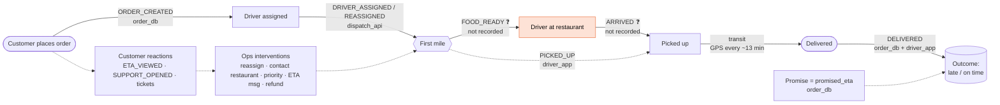
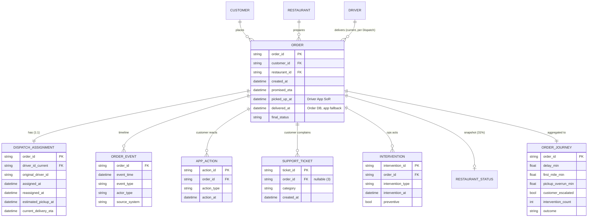
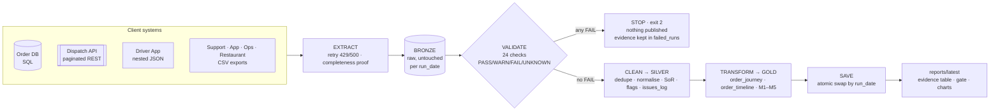

# 03 · Workflow + data model (Class 7)

Raw systems are organised by **source**; the model reorganises them around the **business workflow**.

## 1. The order workflow and who observes each step

**Where the time goes (median minutes, on-time → late):** assignment 2.3 → 2.3 · **first mile 16.6 → 28.8 (+12.2)** · transit 45.5 → 49.0 (+3.5). The step that loses the promise is exactly the one with no reliable events.

## 2. Entities · events · states · interactions · interventions · outcomes

| Concept | In FlashEats | Stored in |
|---|---|---|
| **Entities** (things that persist) | order, customer, restaurant, driver, support ticket | orders / customers / restaurants / drivers / tickets |
| **Events** (things that happen, time-stamped) | ORDER_CREATED, DRIVER_ASSIGNED, DRIVER_REASSIGNED, PICKED_UP, DELIVERED | `order_timeline` (gold) |
| **State** (latest event) | delivered / cancelled; restaurant preparing / ready / handed_off | `final_status`; restaurant snapshot |
| **Interactions** (customer) | ETA_VIEWED, SUPPORT_OPENED, CANCEL_ATTEMPTED, TICKET_* | app actions, tickets |
| **Interventions** (business) | DRIVER_REASSIGNMENT, RESTAURANT_CONTACT, PRIORITY_DISPATCH, ETA_MESSAGE, REFUND_OFFER | ops intervention log |
| **Outcome** | delivered_on_time / delivered_late / cancelled / not_measurable, `delay_min` | `order_journey` (gold) |

## 3. Relational model (order-centric)

## 4. Tables the pipeline publishes (gold)

| Table | Grain | PK | Built from | Answers |
|---|---|---|---|---|
| `order_journey.csv` | 1 row per order (1,600) | `order_id` | orders ⋈ dispatch ⋈ (app actions, tickets, interventions **aggregated first**) | KPI, stage durations, reaction, intervention per order |
| `order_timeline.csv` | 1 row per event (9,682) | `order_id, event_time, event_type` | union of 7 source systems, time-sorted | "what happened to order X, in order?" |
| `kpi_by_definition.csv` · `stage_decomposition.csv` · `intervention_by_type.csv` · `weekly_trend.csv` · `segments.csv` | aggregate | — | `order_journey` | the evidence table |

**Rule:** aggregate one-to-many tables to the order grain *before* joining — a blunt join of orders × actions would multiply rows and inflate every rate.

**Why this model instead of mirroring the 9 source tables:** the system-of-record choices (which pickup time, which driver, which promise) are made **once**, in code, and every consumer inherits them.

## 5. Pipeline layers

