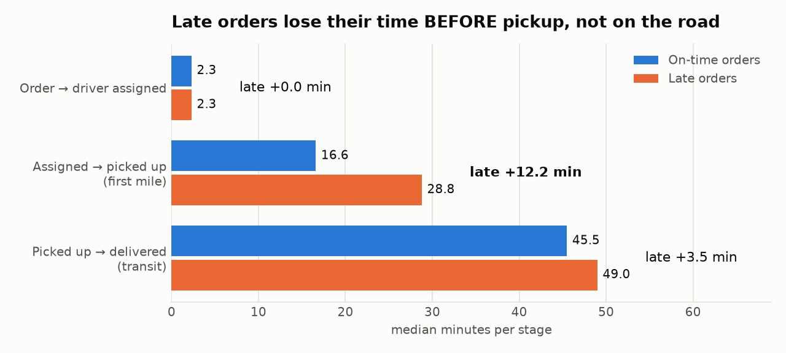
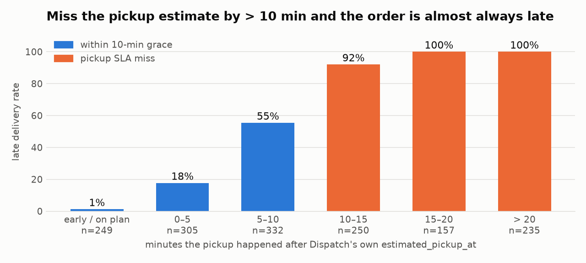

# FlashEats — Late Delivery Evidence Table

*Generated by `run_pipeline.py` · run_date **2026-09-27** · run_id `8cb39712` ·
gate: 11 PASS / 16 WARN / 0 FAIL / 5 UNKNOWN*

> **Decision supported:** do **not** fund the AI delay-predictor yet. 56.5% of deliveries miss the
> promise, and the delay is created **before pickup** (M2) — a controllable dispatch/restaurant hand-off problem
> that the current data cannot yet attribute to restaurant vs driver (no arrival event). Fix and instrument the
> first mile; track M1–M5 weekly with this pipeline.

| # | Metric | Type | Value | Formula (grain) | What it tells the business | Trust |
|---|---|---|---|---|---|---|
| M1 | **Late Delivery Rate** (project KPI) | Outcome · lagging | **56.5%** | late ÷ KPI-eligible delivered orders (863/1528); grain = order | > 10 min late: 23.2% · median lateness 8.0 min | ⚠️ definition not owner-signed (V23) |
| M2 | **Pickup SLA Miss Rate** | Workflow · leading · controllable | **42.0%** | orders picked up > 10 min after Dispatch's estimate ÷ eligible orders | late if missed: 96.9% vs 27.2% if not; pickup overrun ≥ total delay for 92.4% of late orders | ✅ pickup from Driver App (SoR) |
| M3 | **Customer Escalation Rate** | Customer interaction · leading | **29.9%** | late orders with in-app support opened or a ticket ÷ late orders | 52.3% when > 10 min late; tickets alone catch only 19.0% of late orders | ⚠️ ticket categories partly unconfirmed (V16) |
| M4 | **Preventive Intervention Coverage** | Intervention · controllable | **15.2%** | late orders that got a non-refund intervention before the promised ETA ÷ late orders | late rate with preventive intervention 58.5% vs 56.3% with none — no measurable effect yet | ❓ association only; reassignment log ≠ Dispatch (V19) |
| M5 | **ETA Drift** | ETA reliability · diagnostic | **+8.1 min** | median(Dispatch current ETA − promised ETA) | late vs revised ETA 26.2% vs original promise 56.5% | ✅ both from their SoR |

## The KPI depends on the definition (V23)
| definition | population | orders | late_rate_pct |
|---|---|---|---|
| VP Operations — any delivered order after promised ETA  [PUBLISHED] | delivered, completion time from any agreed source, valid promise | 1528 | 56.5 |
| Support Lead — only > 10 min late counts | same as above | 1528 | 23.2 |
| Finance — exclude cancelled/refunded | same as VP Ops (cancelled already excluded) | 1528 | 56.5 |
| Data Team (historical dashboard) — delivered with non-null DB actual time | Order DB only, no recovery, no promise check | 1495 | 56.4 |

Population: 1600 orders → 1528 KPI-eligible
(excluded 68 cancelled, 4 impossible promises,
0 with no completion time anywhere; **37 recovered**
from the Driver App — 64.9% of them were late, so dropping them hid the worst orders).

## Where does the time go? (median minutes)
| stage | on_time_median_min | late_median_min | gap_min |
|---|---|---|---|
| Order -> driver assigned | 2.3 | 2.3 | 0.0 |
| Assigned -> picked up (first mile) | 16.6 | 28.8 | 12.2 |
| Pickup vs Dispatch's own estimate | 1.8 | 13.9 | 12.1 |
| Picked up -> delivered (transit) | 45.5 | 49.0 | 3.5 |
| Delivered vs promise | -5.5 | 8.0 | 13.5 |

## Interventions (association, not causation)
| intervention_type | interventions | preventive | late_rate_pct |
|---|---|---|---|
| DRIVER_REASSIGNMENT | 77 | 77 | 55.8 |
| ETA_MESSAGE | 58 | 58 | 67.2 |
| RESTAURANT_CONTACT | 51 | 51 | 56.9 |
| PRIORITY_DISPATCH | 38 | 38 | 52.6 |
| REFUND_OFFER | 22 | 0 | 45.5 |

## Weekly trend
| week | orders | late_rate_pct | pickup_sla_miss_pct |
|---|---|---|---|
| 2026-W31 | 91 | 52.7 | 38.5 |
| 2026-W32 | 383 | 55.9 | 42.3 |
| 2026-W33 | 390 | 59.2 | 43.8 |
| 2026-W34 | 388 | 57.5 | 43.0 |
| 2026-W35 | 276 | 53.3 | 38.8 |

## Context segments (descriptive only)
| dimension | value | orders | late_rate_pct | median_first_mile | median_transit |
|---|---|---|---|---|---|
| traffic_bucket | high | 434 | 66.1 | 23.6 | 53.0 |
| traffic_bucket | low | 368 | 50.0 | 23.1 | 43.5 |
| traffic_bucket | medium | 599 | 51.6 | 22.8 | 46.8 |
| traffic_bucket | severe | 127 | 65.4 | 21.4 | 61.5 |
| weather_bucket | clear | 1218 | 53.4 | 23.0 | 46.1 |
| weather_bucket | heavy_rain | 72 | 73.6 | 22.3 | 60.0 |
| weather_bucket | rain | 238 | 66.8 | 23.3 | 51.8 |

## Known / Unknown / Assumption / Limitation

| | Statement | Evidence |
|---|---|---|
| **Known** | More than half of deliveries miss the promised ETA (56.5%); about a quarter by > 10 min | M1, V12 |
| **Known** | Delay builds up between driver assignment and pickup; transit is similar for late and on-time orders | stage table, M2 |
| **Known** | Tickets under-count the problem — only 19.0% of late orders produce one | M3 |
| **Unknown** | Whether the restaurant (food not ready) or the driver (arrived late) causes the pickup delay | V20, V24 |
| **Unknown** | Which ETA the customer actually saw — 'past the promised time' tickets arrive before the stored promise | V22 |
| **Unknown** | Whether interventions work — they target at-risk orders and there is no control group | M4, V19 |
| **Unknown** | Who owns the KPI definition — four stakeholder definitions, none signed off | V23 |
| **Assumption** | `promised_eta` in the Order DB is the customer promise; `distance = 18.0` is a default, not a distance | V17, V22 |
| **Assumption** | Driver App `delivered` event = true completion when the Order DB is blank (100% agreement on overlap) | V12 |
| **Limitation** | Single 4-week classroom snapshot (Aug 2026, Bengaluru); descriptive analysis, no causal claims | — |
| **Limitation** | Restaurant status is a last-updated snapshot for ~31% of orders; GPS pings every ~13 min | V20, V24 |
